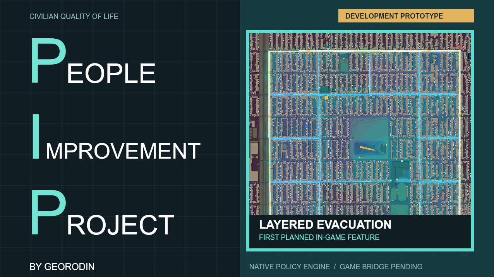

# PIP — People Improvement Project



**Development prototype for Zombies Aren't Real. The evacuation policy is implemented and tested; it is NOT active in the game.** The installed game supports INI setting mutators, not the native host bridge this feature needs. Dropping this project's DLL into the game folder does not load it. This repository is the starting point for a broader civilian quality-of-life mod.

## First feature: layered evacuation

The policy teaches residents a contingency when they enter an intact safe region. Once their region is breached, they try to reach a directly adjacent, unbreached region through a real, passable connection. Arrival teaches that region's next contingency, so a layered base can retreat repeatedly toward its remaining safe interior.

An intact overlap region remains safe even if an outer region is breached. Closed gates, one-way restrictions, walls, buildings and water require a valid path from the host. The policy never teleports civilians. If all adjacent destinations are breached or unreachable, it releases steering to the game's normal panic behaviour and retries later. Death, infection and non-civilian units also release the override.

## Current status

| Part | Status |
| --- | --- |
| Native x64 policy engine (`PIP.Core.dll`) | Implemented |
| Layered retreat, arrival knowledge, blocked routes and replanning | Tested through the DLL's C ABI |
| Game state access, breach events, walking paths and steering | **Missing: no supported code-plugin interface found** |
| In-game playtest and real save/reload integration | Pending the game bridge |
| Editable Photoshop design and preview | In `Photoshop/` and `art/` |
| Steam Workshop metadata, description and release checks | Prepared as a draft; upload blocked |

The test harness supplies synthetic regions, portals, and path results. It does not read the game process. This is not a playable Workshop release, and the included tests do not establish that gameplay integration works.

## Build and test

On Windows x64 with .NET SDK 9 and LLVM Clang plus `ld.lld.exe`:

```powershell
.\scripts\Build.ps1
```

The script can use the Clang/LLD binaries bundled with Unity's Android NDK, if that module is installed. Unity Editor is not used to build the game or the mod. Otherwise pass `-Clang` and `-Linker` with their full executable paths. No packages are installed and no game files or saves are changed.

Output: `build/PIP.Core.dll`. The DLL has a plain C ABI, no entry point, and no runtime imports. `tests/` is a .NET console harness that loads the actual native DLL and exercises the exported functions.

For optional artwork regeneration with Node.js, run `npm install` followed by `npm run preview`. These packages are authoring tools only. The committed PSD is already layered; Photoshop may ask to refresh text layers on first opening.

```powershell
.\scripts\Prepare-Workshop.ps1 -Draft
```

This creates a clearly marked **development package** under `dist/`; it does not publish anything. A normal package attempt fails until verified game integration is recorded in `workshop/metadata.json`.

## Integration and release

See [the integration contract](docs/INTEGRATION.md), [installed-build findings](docs/COMPATIBILITY.md), and [Workshop release checklist](workshop/RELEASE.md). No BepInEx, Harmony, Unity injection or blind executable patch is included. Future people-behaviour modules can be added beside `src/pip.c` under the same PIP name.

The name follows Georodin's [ACI](https://github.com/Georodin/ACI-AbilityCooldownIndicator) and [DDI](https://github.com/Georodin/DDI-DeepDrill-Indicator) acronym style. The new cover follows the DDI PSD's three-line typography and author credit, using original graphics and the supplied game screenshot; it does not reuse the separately licensed mining artwork or RimWorld expansion marks.

